# Architecture

```mermaid
flowchart LR
  subgraph Data
    A[creditcard.csv] --> B[validate + clean<br/>drop duplicates]
    B --> C[causal history features<br/>past-only]
    C --> D[chronological split<br/>70 / 15 / 15]
  end
  subgraph Training
    D -->|train only| E[FeatureBuilder.fit]
    E --> F[imbalance comparison<br/>baseline / weights / SMOTE / under / ADASYN]
    F --> G[Optuna + GridSearch<br/>TimeSeriesSplit, MLflow child runs]
    G --> H[RF + XGB + LGBM<br/>calibrated on last 20% of train]
    H --> I[soft-voting ensemble]
    I -->|validation only| J[F2 threshold]
    J -->|once| K[test evaluation]
    I --> L[SHAP TreeExplainer]
  end
  subgraph MLOps
    K --> M[(MLflow runs)]
    M --> N[Model Registry<br/>ShieldML-Champion @champion]
  end
  subgraph Serving
    N -->|or local bundle| O[FastAPI: loads once at startup]
    O --> P[/predict/]
    O --> Q[/health/]
    O --> R[/metrics<br/>in-memory/]
    P --> S[HistoryStore<br/>causal features]
  end
```

Key invariants: (1) features use only strictly earlier rows; (2) fitted statistics come from train only;
(3) resamplers live inside the training pipeline (never applied to validation/test); (4) threshold is fixed on
validation before the single test evaluation; (5) the model is loaded once at API startup.
